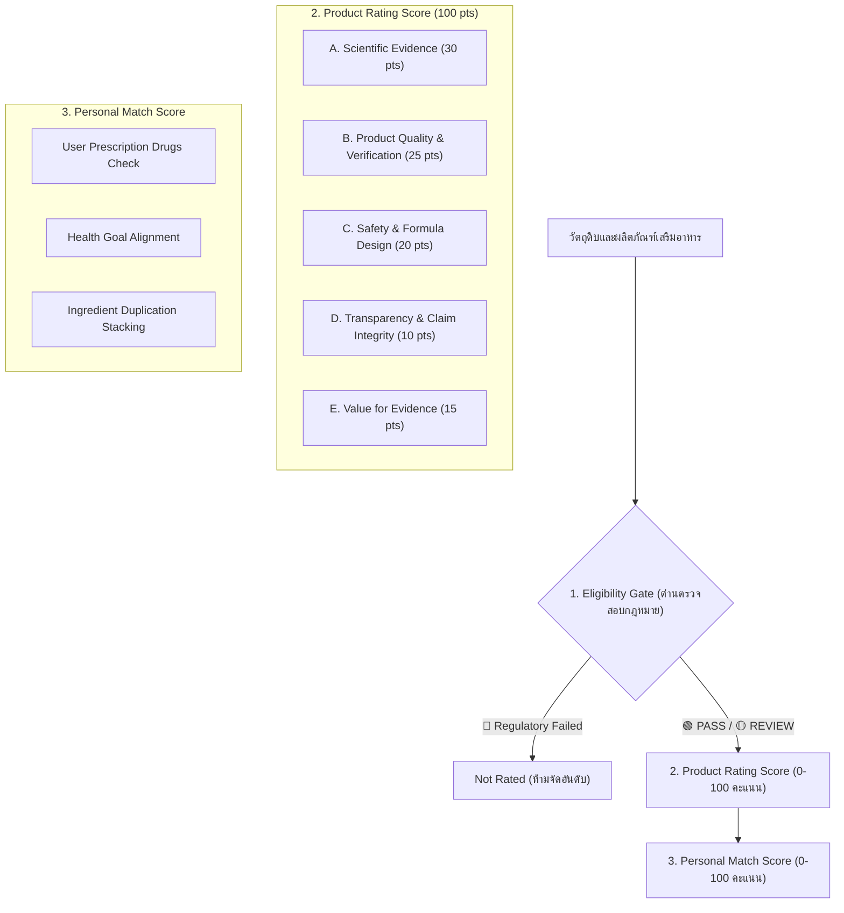

# 🛡️ NutriTrust Next-Version Platform Architecture (v2.0)

> **Independent Supplement Decision-Support Platform**  
> **แนวคิดหลัก**: ระบบช่วยตัดสินใจเลือกผลิตภัณฑ์เสริมอาหารบนหลักฐานทางวิทยาศาสตร์ คุณภาพ ความปลอดภัย และความคุ้มค่าอย่างตรงไปตรงมา ปราศจากอคติทางการตลาด (Academic Neutrality & Regulatory Alignment)

---

## 🎯 1. วิสัยทัศน์และสถาปัตยกรรมระบบ (SEVR Rating Architecture)

แพลตฟอร์มจะไม่ใช้คะแนนดาวลอยๆ (เช่น ⭐ 4.8/5) หรือคะแนนรวมเดียวตั้งแต่ต้น เนื่องจากคุณภาพของผลิตภัณฑ์ หลักฐานทางวิชาการ ความปลอดภัย และความเหมาะสมกับแต่ละบุคคลเป็นคนละมิติกัน

 NutriTrust จึงกำหนดมาตรฐาน **SEVR (Supplement Evidence & Value Rating)** แบ่งการประเมินออกเป็น **3 ชั้นหลัก**:

---

## 🚦 2. ชั้นที่ 1: Eligibility Gate (ด่านตรวจสอบก่อนให้คะแนน)

ตรงนี้ **ไม่มีการให้คะแนน** มีเพียง 3 สถานะความปลอดภัยทางกฎหมายและกฎระเบียบ อย. ไทย (ประกาศกระทรวงสาธารณสุข ฉบับที่ 447 และ 448):

- 🟢 **PASS**: ผ่านการตรวจสอบทุกข้อ ดำเนินการประเมินต่อได้
- 🟡 **REVIEW**: ข้อมูลบางส่วนอยู่ระหว่างรอใบรับรองเพิ่มเติม
- 🔴 **DO NOT RATE / NOT RATED**: ไม่ผ่านเกณฑ์กฎหมาย ห้ามให้คะแนนเพื่อป้องกันความเข้าใจผิด

### 📋 6 เกณฑ์การตรวจเช็ค (Gate Controls):
1. **G1 Regulatory**: ตรวจสอบเลขสารบบ อย. และสถานะการอนุญาตจริง
2. **G2 Ingredient Legality**: ส่วนประกอบอยู่ในประเภทและปริมาณที่อนุญาตตามกฎหมาย
3. **G3 Label Integrity**: แสดงฉลากและข้อมูลสำคัญถูกต้องครบถ้วน
4. **G4 Claims Compliance**: ไม่มีข้อความโฆษณาโอ้อวดอ้างผลทางการรักษาโรค (ไม่ทำให้เข้าใจผิดว่าเป็นยา)
5. **G5 Safety Alert**: ไม่มีประวัติถูกถอนใบอนุญาต สารสั่งห้าม หรือคำเตือนร้ายแรงจาก อย.
6. **G6 Identity Verification**: ระบุตัวตนผู้ผลิต โรงงาน สถานที่ผลิต และสูตรการรับประทานได้ชัดเจน

> [!CAUTION]
> หากผลิตภัณฑ์ไม่ผ่าน Gate สำคัญ เช่น เลข อย. ไม่ตรงกับผลิตภัณฑ์ ระบบจะไม่ตัดคะแนนเป็น 60/100 แต่จะแสดงสถานะชัดเจนว่า:  
> **🔴 Not Rated — Regulatory Verification Failed**

---

## 📊 3. ชั้นที่ 2: Product Rating Score (0 – 100 คะแนน)

ประเมินว่า *"ผลิตภัณฑ์นั้นมีคุณภาพและหลักฐานทางวิทยาศาสตร์ดีแค่ไหนในฐานะผลิตภัณฑ์"* แบ่งออกเป็น 5 หมวดหลัก:

| หมวดการประเมิน (Rating Category) | น้ำหนักคะแนน | รายละเอียดและเป้าหมายการตรวจเช็ค |
| :--- | :---: | :--- |
| **A. Scientific Evidence** | **30 คะแนน** | คุณภาพของหลักฐานงานวิจัย PubMed/NCBI และความสอดคล้องของปริมาณสารสกัด |
| **B. Product Quality & Verification** | **25 คะแนน** | มาตรฐานโรงงานสกัดต้นน้ำ ใบรับรอง CoA และการตรวจสอบจากแล็บอิสระ |
| **C. Safety & Formula Design** | **20 คะแนน** | ความปลอดภัยของขนาดรับประทาน ปฏิกิริยาระหว่างยากับสารสกัด (Drug Interactions) |
| **D. Transparency & Claim Integrity** | **10 คะแนน** | การเปิดเผยปริมาณสารสกัดจริง (ไม่หมกเม็ด Proprietary Blend) และความตรงไปตรงมา |
| **E. Value for Evidence** | **15 คะแนน** | ดัชนีความคุ้มค่าราคาต่อปริมาณสารสกัดที่หวังผลทางคลินิกได้จริง (Evidence Cost/Day) |
| **รวมคะแนนทั้งหมด** | **100 คะแนน** | **คะแนนรวมคุณภาพระดับผลิตภัณฑ์ (Product Quality Rating)** |

---

### 🔬 รายละเอียดเจาะลึก 5 หมวดประเมิน

#### A. Scientific Evidence (30 คะแนน)
- **A1 Evidence Certainty (12 คะแนน)**: อิงหลักเกณฑ์ **GRADE Framework** ประเมินระดับความน่าเชื่อถือของงานวิจัยทางคลินิกในมนุษย์ (Systematic Review, RCTs) แยกตามผลลัพธ์การรักษา (Outcome)
- **A2 Dose Match (6 คะแนน)**: เปรียบเทียบปริมาณสารสกัดต่อวันในผลิตภัณฑ์กับ Dose ที่พบผลลัพธ์ทางคลินิกจริง
- **A3 Ingredient / Form Match (6 คะแนน)**: ตรวจสอบรูปแบบสารสกัด (Chemical form, Standardization, Bioavailability) ว่าตรงกับงานวิจัยหรือไม่
- **A4 Population Match (3 คะแนน)**: ความสอดคล้องของกลุ่มประชากรที่ทดลอง (Healthy adults, ผู้สูงอายุ, นักกีฬา)
- **A5 Outcome Relevance (3 คะแนน)**: น้ำหนักคะแนนผลลัพธ์ทางคลินิก (Clinical Endpoints) เหนือกว่า Surrogate Biomarkers

#### B. Product Quality & Verification (25 คะแนน)
- **B1 Manufacturing Quality (5 คะแนน)**: มาตรฐานโรงงานผลิต (GMP, PIC/S, ISO)
- **B2 Identity & Potency (6 คะแนน)**: เอกสารใบรับรองผลวิเคราะห์จากห้องแล็บ (Certificate of Analysis - CoA)
- **B3 Contaminant Testing (5 คะแนน)**: ตรวจสอบสิ่งเจือปน โลหะหนัก และเชื้อจุลินทรีย์ (Heavy metals, Microbial testing)
- **B4 Independent Verification (5 คะแนน)**: การรับรองจากสถาบันภายนอกอิสระ (Third-party verification เช่น USP, NSF/ANSI 173)
- **B5 Stability & Traceability (4 คะแนน)**: ระบบการตรวจสอบย้อนกลับห่วงโซ่อุปทาน (Lot Traceability & Stability)

#### C. Safety & Formula Design (20 คะแนน)
- **C1 Dose Safety (6 คะแนน)**: ความปลอดภัยของปริมาณสารสกัด ไม่สูงเกินไปจนเกิดความเสี่ยงสะสม
- **C2 Drug-Supplement Interaction Transparency (5 คะแนน)**: ระบบแจ้งเตือนปฏิกิริยาระหว่างสารสกัดอาหารเสริมกับยาประจำตัว
- **C3 Contraindication & Risk Groups (4 คะแนน)**: คำเตือนสำหรับกลุ่มเสี่ยง (สตรีมีครรภ์, ผู้ป่วยโรคไต, ผู้สูงอายุ)
- **C4 Formula Duplication / Stacking Risk (3 คะแนน)**: การประเมินความเสี่ยงจากการรับประทานสารสกัดที่มีฤทธิ์ซ้ำซ้อนกัน
- **C5 Adverse-Event / Recall Signal (2 คะแนน)**: การเชื่อมโยงข้อมูลเฝ้าระวังความปลอดภัย (Health Product Vigilance Center)

#### D. Transparency & Claim Integrity (10 คะแนน)
- **D1 Full Formula Disclosure (3 คะแนน)**: ระบุปริมาณสารสกัดจริงครบถ้วน ไม่ใช้ Proprietary Blend ซ่อนปริมาณ
- **D2 Evidence-Linked Claims (3 คะแนน)**: ข้อความบนฉลากมีงานวิจัย PubMed อ้างอิงตรวจสอบได้
- **D3 Marketing Accuracy (2 คะแนน)**: การโฆษณาตรงกับระดับงานวิจัย ไม่ใช้คำโฆษณาเกินจริง
- **D4 Conflict Disclosure (2 คะแนน)**: การเปิดเผยความขัดแย้งทางผลประโยชน์และแหล่งทุนวิจัย

#### E. Value for Evidence (15 คะแนน)
- **E1 Cost per Evidence-Aligned Daily Dose (8 คะแนน)**: คำนวณราคาจริงต่อวันที่ได้ปริมาณสารสกัดหวังผลทางคลินิก
- **E2 Active Ingredient Value (4 คะแนน)**: ดัชนีบาทต่อ 100mg ของสารสกัดออกฤทธิ์มาตรฐาน (Standardized Active Compound)
- **E3 Formula Utilization (3 คะแนน)**: การหักคะแนนส่วนผสมใส่ประดับฉลาก (Label Decoration Penalty)

---

## 👤 4. ชั้นที่ 3: Personal Match Score (0 – 100 คะแนน)

> **"ผลิตภัณฑ์คะแนน 92/100 อาจมี Personal Match แค่ 25/100 สำหรับบางคน"**

ชั้นนี้คำนวณความเหมาะสมเฉพาะบุคคล โดยวิเคราะห์จาก:
1. **ประวัติการใช้ยาประจำตัว**: เช่น ยาละลายลิ่มเลือด ยาลดความดัน (ตัดคะแนนหากมีปฏิกิริยาระหว่างกัน)
2. **เป้าหมายสุขภาพเฉพาะบุคคล**: เช่น บำรุงข้อต่อ สายตา นอนหลับ หรือชะลอวัย
3. **ภาวะซ้ำซ้อนของการรับประทานอาหารเสริมเดิม**: ป้องกันการได้รับสารสกัดชนิดเดียวกันเกินขนาดปลอดภัย (UL)

---

## 🏷️ 5. สรุปเกณฑ์การแสดงผลคะแนน (Score Classification)

| ช่วงคะแนน (Score Range) | ระดับการจัดเกรด (Rating Band) | คำอธิบายความหมาย |
| :---: | :---: | :--- |
| **90 – 100** | 🟢 **Exceptional** | คุณภาพระดับดีเยี่ยม มีหลักฐานวิจัยและใบรับรองครบถ้วนสูงสุด |
| **80 – 89** | 🟢 **Strong** | คุณภาพสูง มีหลักฐานทางวิทยาศาสตร์และมาตรฐานรองรับแน่นหนา |
| **70 – 79** | 🟡 **Good** | คุณภาพดี อยู่ในเกณฑ์มาตรฐานสากล |
| **60 – 69** | 🟡 **Acceptable** | คุณภาพยอมรับได้ แต่มีจุดที่ต้องพัฒนาเพิ่มเติม |
| **50 – 59** | 🟠 **Weak** | หลักฐานหรือมาตรฐานยังไม่ชัดเจน |
| **< 50** | 🔴 **Poor** | ไม่แนะนำ คุณภาพหรือข้อมูลไม่เพียงพอ |
| **Gate Fail** | 🔴 **Not Rated** | ไม่ผ่านเกณฑ์กฎหมาย/ regulatory check |

---

## 📝 6. Implementation Tasks & Current Project Status Checklist

ตารางตรวจสอบสถานะการพัฒนาโครงการปัจจุบัน (**Current Project Status Audit**) เทียบกับข้อกำหนดของแพลตฟอร์ม NutriTrust v2.0:

### 🚦 Epic 1: Regulatory & Eligibility Gate Engine
- [x] **Task 1.1**: ระบบจัดเก็บเลขสารบบ อย. (`fda_number`) และประเภทการลงทะเบียนใน `models/Product.ts` และ DB
- [x] **Task 1.2**: ระบบตรวจสอบและแสดงผลคำเตือน Regulatory Compliance ไม่ใช้ข้อความเกินจริง
- [x] **Task 1.3**: การแสดงผลสถานะ `Not Rated` กรณีไม่พบข้อมูล อย. หรือเอกสารไม่สมบูรณ์

### 🔬 Epic 2: SEVR 100-Point Rating Engine Implementation
- [x] **Task 2.1 (Scientific Evidence 30 pts)**: ระบบเชื่อมโยง PubMed Clinical Studies (`science_summaries_mockup.json`) พร้อม Badge 3 เฉดสีเขียวตามระดับความน่าเชื่อถือ
- [x] **Task 2.2 (Dose & Form Match)**: ระบบเปรียบเทียบปริมาณสารสกัดต่อหน่วยรับประทาน (per Serving Volume) ในตาราง `IngredientCompare.tsx`
- [x] **Task 2.3 (Product Quality & Verification 25 pts)**: ระบบแสดงผลตารางวัตถุดิบต้นน้ำ (Upstream Raw Material Provider) เช่น DSM, Kemin, Kaneka
- [x] **Task 2.4 (Safety & Interaction Alert 20 pts)**: กล่องแจ้งเตือนปฏิกิริยาระหว่างยากับสารสกัดสำหรับผู้สูงอายุและนักกีฬา (Drug Interaction Alert Banner)
- [x] **Task 2.5 (Transparency 10 pts)**: การเปิดเผยปริมาณสารสกัดจริงครบถ้วน ปราศจาก Proprietary Blend ซ่อนปริมาณ
- [x] **Task 2.6 (Value for Evidence 15 pts)**: ดัชนีคำนวณราคาต่อสารสกัดออกฤทธิ์ 100mg (Price per 100mg Active Compound Index) ใน `ValueComparison.tsx`

### 👤 Epic 3: Personal Match & AI MCP Assistance
- [x] **Task 3.1 (Anonymous Profile Health Goal Capture)**: ฟอร์มเก็บเป้าหมายสุขภาพและปัญหาสุขภาพ (`health_issues`) ในหน้า `/survey` เพื่อใช้เป็น Prompt ตั้งต้นให้ระบบ AI
- [ ] **Task 3.2 (Dynamic Personal Match Algorithm 0-100)**: ระบบคำนวณคะแนน Personal Match สด อิงตามยาประจำตัวผู้ใช้ (วางแผนสำหรับ Next Version)
- [ ] **Task 3.3 (Thai FDA Live API Gateway Integration)**: ระบบเชื่อมต่อ API ดึงข้อมูลสถานะ อย. ไทยอัตโนมัติแบบ Real-time (วางแผนสำหรับ Next Version)
